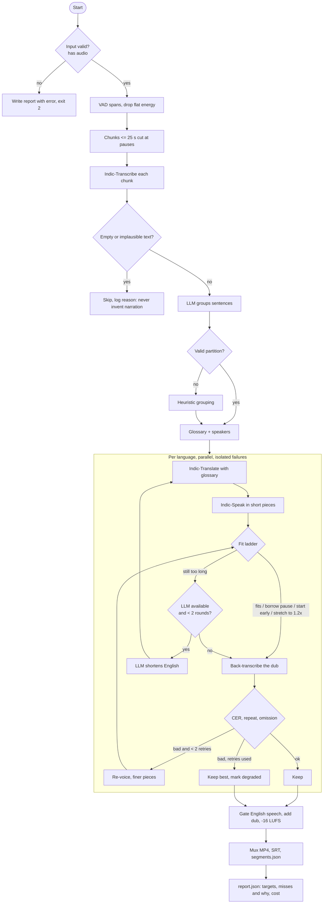

# Design notes

## Principles

1. **Bodhan models do all language work.** Transcription, translation and speech are only ever called through `bodhan.py`. The LLM sees and returns English only; output containing Indic script is rejected in `llm.py`.
2. **Every LLM decision has a deterministic fallback**, so the pipeline runs without an LLM and a bad LLM reply never breaks a run.
3. **Check, don't trust.** Each dubbed line is transcribed back and judged before it is used.
4. **Degrade, don't stop.** A failing line, language or API call is logged and reported; everything else continues.
5. **Cache every paid call**, so reruns and UI edits cost only what changed.

## Flow chart with retries, checks and decisions

## Where each hard part is handled

| Hard part | Approach | Code |
|---|---|---|
| Duration drift | A ladder, cheapest and most natural first: fit, borrow the pause after, start up to 250 ms early, stretch at most 1.2x, then shorten the English and re-translate. Never more than 1.2x. A miss is reported with its reason. | `timing.py`, `pipeline.LangRun.segment` |
| Window limits | Chunks cut at pauses, at most 25 s, never inside speech unless unavoidable (flagged). Sentences are rebuilt from chunks before translation. TTS gets one sentence at a time. | `segmentation.py`, `textutil.split_for_tts` |
| Context and terminology | Whole sentences are translated, not fragments. Glossary from you and the LLM; your renderings are substituted before translation; pinned terms and numbers are checked after and flagged. | `llm.build_glossary`, `LangRun.translate` |
| Model misbehaviour | Back-transcribe every dub. Repeats, missing tails and large mismatches trigger a retry with finer text pieces; best attempt kept; optional LLM judge for borderline lines. | `qa.py`, retry loop |
| Speakers | No diarization available, so segments are grouped by median pitch into at most two speakers, each mapped to the language's own male or female voice, consistent for the whole video. Overridable. | `audio.assign_speakers`, `pick_voice` |
| Silence and music | Adaptive VAD relative to the clip; flat-energy spans rejected; empty or implausible transcripts skipped with a reason; the dub is only ever placed at a transcribed sentence. The original background is kept wherever nobody speaks. | `segmentation.energy_spans`, `audio.render_mix` |

## Where the LLM decides, and the fallback

| Decision | Input | Output | Fallback |
|---|---|---|---|
| Group fragments into sentences | numbered English fragments with times | partition of indices | punctuation and pause heuristic; invalid partitions rejected |
| Glossary | English transcript | up to 40 terms that occur in it | empty glossary (user terms still apply) |
| Shorten English | one sentence, target ratio, protected terms | shorter English | cap speed at 1.2x, mark degraded, report |
| Judge a borderline dub | English, translation, back-transcript | ok or not | trust the error-rate metrics |

## Sync and quality checks

- Placement: each dubbed line starts at its source start, or at most 250 ms earlier when it needs room. Offsets are reported per line; the target is within 300 ms.
- Overrun: a clip may not run into the next sentence; it is trimmed at the next start and noted.
- Length: the output is muxed with `-t <input duration>` and measured afterwards (target within 100 ms).
- Loudness: speech is measured and normalized to -16 LUFS, with a peak ceiling of about -1 dBFS; the measured value is reported.
- Fidelity: character error rate of the back-transcript against the translation, per segment and mean.

## Failure recovery

| Failure | Recovery |
|---|---|
| 429 / 5xx / timeout | exponential backoff honoring `Retry-After`, up to 5 attempts, concurrency-limited; counted in the report |
| Translation truncated | split the sentence and translate the halves; never cached |
| Repeated / dropped speech | re-voice with finer pieces, keep the best attempt |
| One segment fails | other segments continue; it is listed as failed with the error |
| One language fails | other languages continue; exit code 1; report and partial outputs written |
| Wrong key / endpoint (401, 403, 404) | preflight probe of translate and speak before any transcription spend; fails in seconds with a plain-English hint, exit code 2 |
| Source analysis fails (no audio, bad file) | report with the error, exit code 2 |
| Re-run | all paid calls are cached; unchanged lines cost nothing |

## Web studio

A thin FastAPI app plus one static page. It uploads a file, starts `run_pipeline`, polls `run.log.jsonl` for progress, and serves the segments, report and media the pipeline wrote. Edits are saved as `out/<lang>/overrides.json` (English, target text, voice, style, speed) and the language is re-run; the cache makes this cost only the changed line. Overrides are whitelisted and speed is clamped to 0.85-1.2x on the server.

## What I would do next

Calibrate QA thresholds on real runs; add source separation to keep music under speech; speaker diarization from an allowed source; Indic-OCR for on-screen text; reading-speed subtitle splitting; per-job isolation and auth for the web studio.
